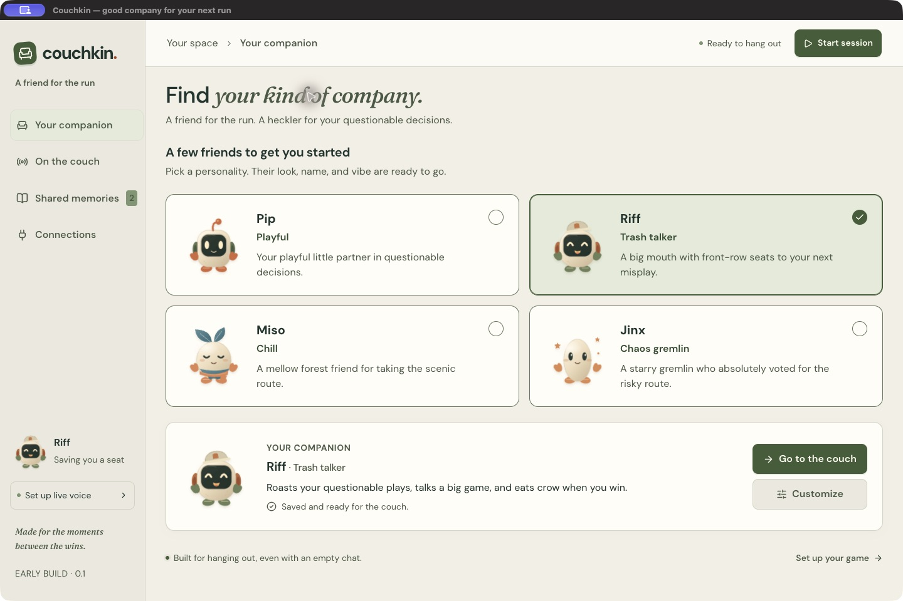
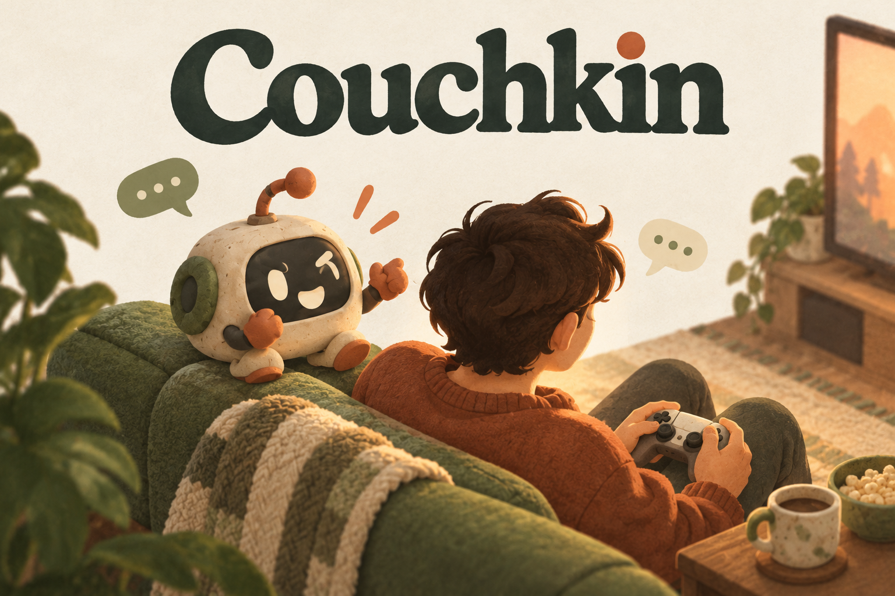

# Couchkin

**A little friend on the couch, with big opinions about your next move.**

Couchkin is a desktop companion for Twitch streamers, currently tested on macOS. Pick a character, let it follow your game through OBS, and talk to it while you play. It joins your stream as an animated overlay, brings its own personality, remembers selected shared moments, and lets viewers join the conversation.

Built with OpenAI Codex for the **Codex × TwitchCon Hackathon**. This is an independent prototype, not an official OpenAI or Twitch product.

**Current status:** Desktop prototype tested on Apple Silicon macOS; 358 tests passing; real voice, OBS, memories, and Twitch sign-in exercised. The first outgoing Twitch reply and final broadcast mix still need a combined rehearsal.

**Want Codex to set it up? [Copy this setup prompt](docs/codex-setup-prompt.md).**



*Screenshot of the actual desktop app. This image is not proof of a live Twitch broadcast.*

## What you can do

- **Pick your company:** Pip is playful, Riff talks trash, Miso is chill, and Jinx brings chaos. Customize appearance, personality, talkativeness, backseat energy, and spoiler preferences.
- **Talk naturally:** OpenAI live voice listens through your selected microphone and responds through the desktop or OBS. The microphone picker and level meter are independent of OBS's input settings.
- **Share the game:** OBS supplies screenshots of your chosen game source. Periodic observations and speech-triggered refreshes help the companion follow changing gameplay; its tools can look up game information.
- **Bring a character on stream:** A transparent Browser Source carries animation, captions, and voice. Preset companions blink, glance, react, and move while speaking. Original PNG artwork can also be generated with Codex where its image tool is available.
- **Include chat:** Addressed viewers can receive spoken replies and optional text replies. Text posting uses Twitch sign-in, a default 45-second cooldown, duplicate protection, and a visible sender identity.
- **Keep shared memories:** Review, add, delete, or disable local memories. Automatic saving looks for gameplay preferences and moments supported by the streamer's own words.

## Run from source

The instructions below were tested on **Apple Silicon macOS with OBS Studio**. Use **Node.js 24 LTS** and npm. The package's minimum Node version is 22.12. OpenAI live voice requires your own API key and API balance; it is billed separately from a ChatGPT subscription. Headphones are recommended.

The Electron core can target Windows, but **Windows is not yet supported by a verified build**. Packaged overlay/artwork paths need compatibility fixes; automatic OBS discovery, optional system speech, Codex executable discovery, and installer/device testing also need a Windows pass. See [platform status](docs/how-it-works.md#platform-status).

```sh
git clone https://github.com/banjtheman/couchkin.git
cd couchkin
npm ci
cp .env.example .env
# Edit .env locally and set OPENAI_API_KEY.
npm run dev
```

Keep `.env` private. Restart the app after changing it. The desktop main process reads the key; it is not embedded in the renderer, settings, overlay, or app package.

The **Codex CLI is optional** for generated character artwork and the earlier Mac voice + Codex conversation mode. Install it separately and run `codex login`. That integration was tested with Codex 0.159.3; your plan's features and usage limits apply. Set `COUCHKIN_CODEX_BIN` in your local environment if Codex is installed outside the app's search paths. See [Codex runtime details](docs/codex-runtime.md).

## Your first session

1. Pick a companion and choose **Use [name]**. This saves the character; it does not start a paid voice session.
2. Open OBS and enable **Tools → WebSocket Server Settings**. In Couchkin's **Connections**, choose **Connect local OBS** and select the original game or capture-card input. Avoid selecting the finished scene containing Couchkin itself.
3. Choose **Add to OBS** to create the transparent overlay in the current scene. Keep that Browser Source active across scenes. In OBS, use **Monitor and Output** for the Couchkin source if you want to hear it in headphones; avoid capturing that monitored output again as desktop audio. **Preview overlay** is a silent visual check.
4. On **On the couch**, enter the game title, choose your microphone, and start the session. Then choose **Enable live mic**. Allow macOS microphone access when prompted. Use **Look at the game**, or enable automatic watching, to provide game context.
5. Optional: enter your Twitch channel in **Connections**. **Listen to chat** is read-only. For posting, choose **Sign in to reply**, approve Twitch's chat permissions, and enable **Reply in Twitch chat**. The bundled public Client ID identifies Couchkin; it grants no account access by itself.

Viewers can address the companion's name or “Couchkin.” Text replies begin with the character's name but appear under the Twitch account you authorized. The cooldown is adjustable from 30 to 300 seconds. The sending account's own messages are ignored to prevent loops, so use another viewer account for testing. A channel does not need to be broadcasting to test its chat.

**Pause, Quiet, or Escape stops live voice and microphone capture.** Changing the companion, game source, game title, or voice can also pause the session. Resume explicitly when ready. A connected live session can incur usage while waiting, so pause when finished. Setup and troubleshooting: [voice and microphone](docs/live-voice.md), [Twitch chat](docs/twitch-chat.md), [memories](docs/memories.md).

## A little friend on the couch



*Original brand illustration, not a product screenshot.* [How the app works](docs/how-it-works.md) explains the local and cloud components.

## How Codex was used

Codex was the development collaborator throughout the build: turning the initial couch-buddy idea into an Electron app, implementing the OBS and Twitch integrations, refining the UI, writing regression tests, and investigating playtest failures. Real feedback led to an explicit microphone picker, speech-triggered screen refreshes, stronger personalities, Live memory saving, and bounded Twitch replies.

The default live conversation runs through **OpenAI GPT-Live (`gpt-live-1`)**. The **Responses API** handles delegated tools, screen observations, memory extraction, and separate public chat replies. **Codex app-server** powers optional original artwork and the earlier conversation mode. [Submission story and technology explanation](docs/devpost-submission.md).

## Current verification and limits

As of October 30, 2026:

- A clean export of the tracked source passed `npm ci` and `npm run check`: **358 tests across 18 files**, TypeScript checking, and the production build. No local keys or settings were needed for those checks. The dependency audit reported no known advisories.
- Real OBS capture, overlay audio, microphone conversation, incoming Twitch chat, and memory saving have been exercised. An **18-minute Riff gameplay rehearsal** ended with an intentional pause and positive user feedback, while recording recovered observation failures and nonterminal request errors.
- Twitch account authorization and the authenticated connection are verified. **An actual outgoing reply, its cooldown in a real channel, and the final broadcast audio mix still need a combined live rehearsal.**

Screen understanding uses sampled images, **not continuous video**. Public text replies use the game title, addressed message, personality, and recent public replies; they do not receive private voice transcripts, memories, or the current game frame. Generated PNG characters use simple motion rather than generated expression sheets or lip sync.

The cause of an earlier unexpected voice disconnect remains unproven; the later successful run does not establish sustained reliability. Windows, a second Mac, and downloaded-app onboarding have not been verified. See the [verification record](docs/verification.md) for evidence and remaining checks.

## Privacy and local data

Settings, memories, generated images, and temporary captures live in Electron's application-data directory on your device. Selected screenshots, conversation context, and relevant memories are sent to OpenAI; microphone audio is streamed while enabled. This is a local desktop app with cloud model calls, not an entirely offline assistant.

OBS passwords and Twitch access tokens stay in memory for the current connection. Twitch requires sign-in again after restart or token expiry. Codex manages its own login; Couchkin does not copy account files. Temporary captures and audio are bounded and cleared at startup/shutdown, although a force-quit can leave files until the next launch.

The overlay listens only on `127.0.0.1:43128` and uses a private pairing URL. It receives companion presentation and playback data, not API keys, settings, private user messages, memories, or captured game images. Keep that URL out of recordings. Chat, game pixels, and retrieved pages are treated as untrusted data; companion tools cannot control gameplay or start a broadcast.

## Development

```sh
npm run check       # Type checking, regression tests, production build
npm run preview     # Launch the production Electron build
npm run dist:mac    # Build a local, ad-hoc signed .app in release/
```

Electron, React, and TypeScript form the app. Main-process bridges own model calls, OBS, Twitch, persistence, and speech; a narrow validated preload API connects the interface. A loopback HTTP/WebSocket server serves the overlay. No Couchkin cloud server or database is required. CI runs the installation and checks on pushes and pull requests.

The local Mac package is **not Developer ID signed or notarized**. This repository is a source release for a prototype, not a polished public installer. Distribution work includes signing, notarization, bundled dependency notices, and broader machine testing.

Code is [MIT licensed](LICENSE). Font OFL licenses are included under `src/renderer/public/licenses/`. Original generated visual concepts and their provenance are in `output/imagegen/`; they are labeled separately from application screenshots. Game and service names belong to their respective owners.
