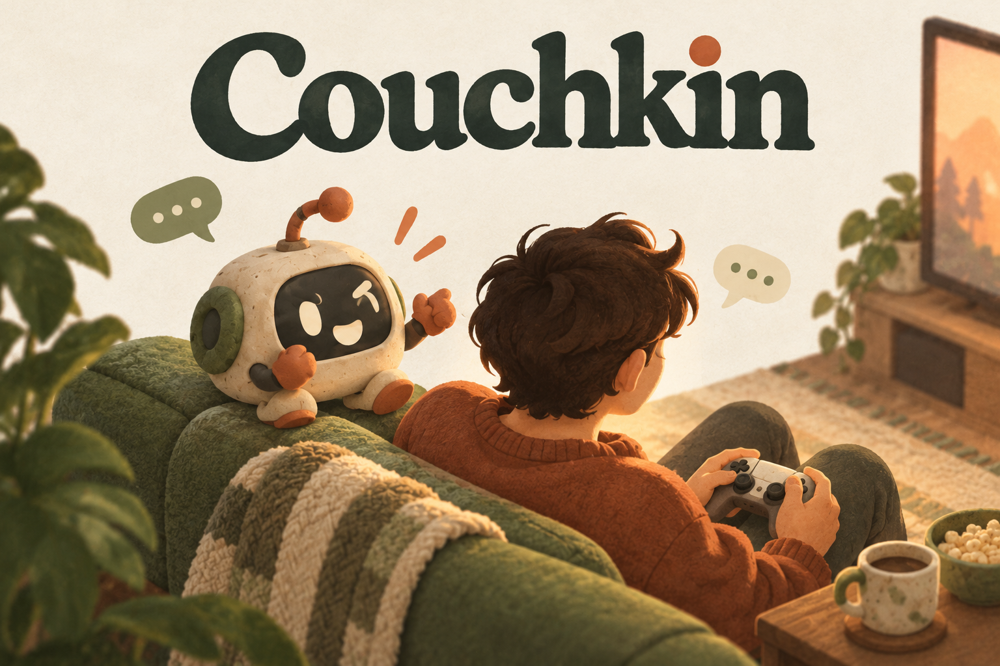
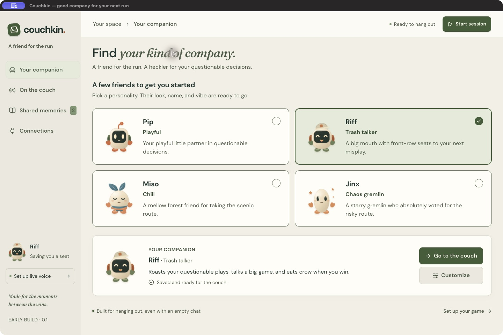
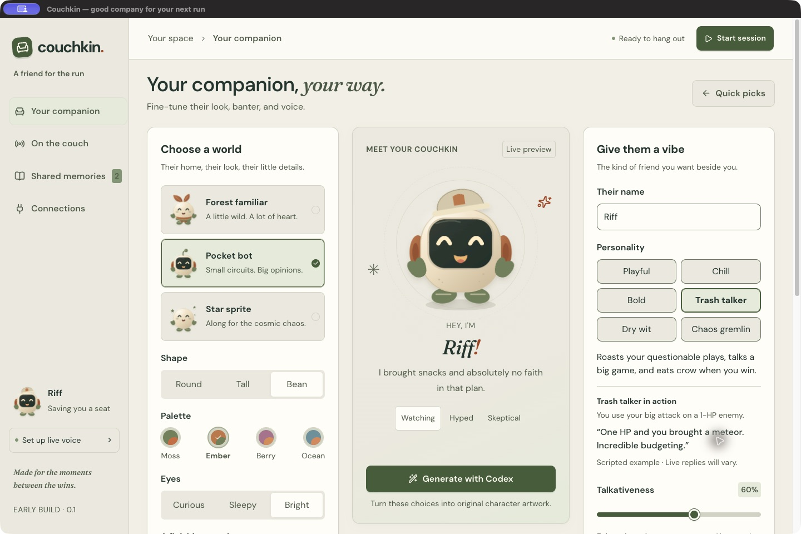
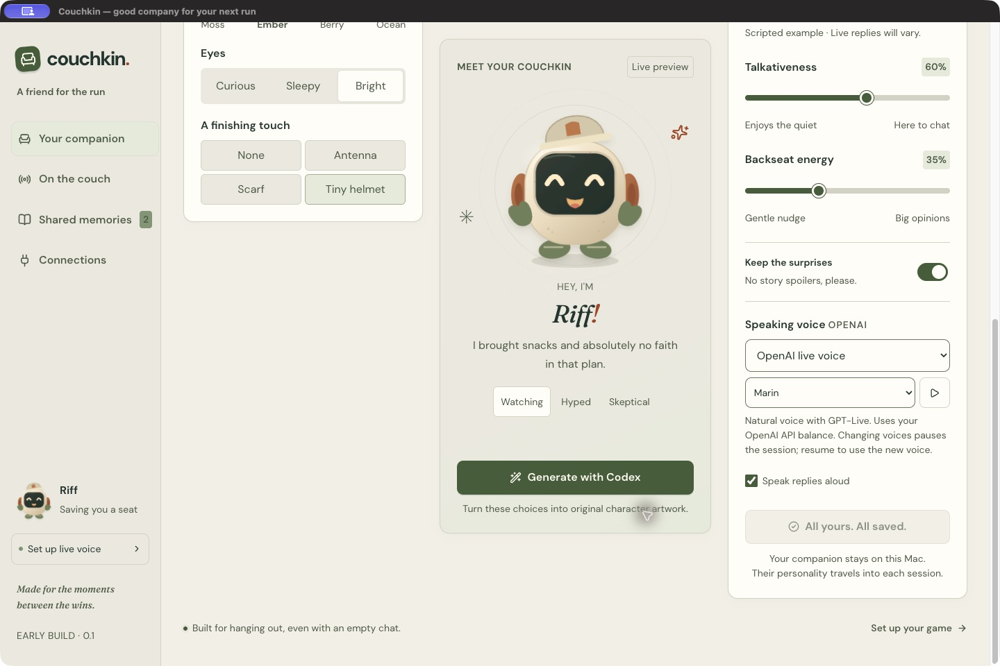

# Couchkin — Devpost gallery

Four ready-to-upload PNGs, listed in the recommended order. All use the suggested 3:2 ratio and are below the 5 MB per-image limit. The three app screenshots are original captures from the packaged desktop app; the cover is clearly labeled artwork.

Download the original images below. If using the prepared local gallery folder, upload the four numbered PNGs in order; do not upload the captions file or ZIP itself.

## 1. Cover artwork

[Download PNG](../output/imagegen/06-couchkin-cover.png) · 1536 × 1024 · 2.21 MB

**Caption:** A little friend on the couch, with big opinions about your next move. Original Couchkin brand illustration.

## 2. Quick picks

[Download PNG](../output/screenshots/couchkin-app-quick-picks.png) · 1440 × 960 · 0.16 MB

**Caption:** Pick your company: playful Pip, trash-talking Riff, chill Miso, or chaotic Jinx. Actual desktop app.

## 3. Character creator

[Download PNG](../output/screenshots/couchkin-app-creator.png) · 1440 × 960 · 0.20 MB

**Caption:** Make your companion your own: choose their look, name, and personality. Actual desktop app; scripted personality example shown.

## 4. Personality and voice

[Download PNG](../output/screenshots/couchkin-app-personality.png) · 1440 × 960 · 0.16 MB

**Caption:** Tune the banter: adjust talkativeness, backseat energy, spoiler preferences, and speaking voice. Actual desktop app.

## Strongest next addition

Capture a real gameplay view showing Riff in the OBS overlay. That will demonstrate the stream experience alongside these interface screenshots. The images above do not claim to show a live broadcast.

Optional later images: [shared memories](../output/screenshots/shared-memories-desktop.png) and [Twitch reply controls](../output/screenshots/twitch-chat-replies.png). These use demonstration data and should keep that label. Their dimensions are not 3:2.
